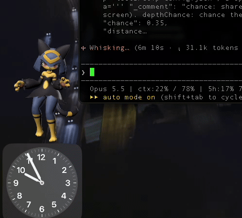
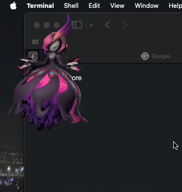

# SekhPet

A macOS menu-bar app that puts 3D desktop pets on your screen, plus a pipeline that turns Palworld pals from your own copy of the game into pets.

<p align="center">
  
  
</p>

Pets idle, wander along the bottom of the screen, play their game animations as random "surprises", watch your cursor, and react when you click, double-click or drag them. Several can be out at once, each at its in-game relative size.

**No game assets are included.** This repository is only the engine and the conversion tools. To make pets you need your own installed copy of Palworld, and the packs you make are built from the game's assets, so keep them to yourself. Not affiliated with or endorsed by Pocketpair.

## Requirements

- **Mac:** macOS 15 or later, Xcode command-line tools (Swift 6), [Blender](https://www.blender.org) 5.x, and Python 3 with [Pillow](https://pypi.org/project/pillow/) (`python3 -m pip install Pillow`).
- **The machine with the game (Windows or Linux):** Python 3.9 or later. The extractor downloads [repak](https://github.com/trumank/repak) to read the game's `.pak` file.

## Quick start

On the Mac, once:

```sh
bash scripts/setup_tools.sh          # .NET, CUE4Parse, UEFormat and the Palworld type mappings, into .tools/
bash scripts/build_app.sh --install  # builds SekhPet.app into /Applications
```

Once you've made a pet, `bash scripts/build_app.sh --install --icon-pet <Pal>` rebuilds the app with an icon rendered from it.

On the machine with the game, copy `scripts/extract_pal.py` there and run:

```sh
python3 extract_pal.py --list        # internal names, e.g. KingWhale is Panthalus
python3 extract_pal.py KingWhale     # writes KingWhale-extract.zip
```

It finds the usual Steam install; otherwise pass `--pak <path to Pal-Windows.pak>`. Copy the zip to the Mac, then:

```sh
bash scripts/make_pet.sh KingWhale-extract.zip    # several zips at once is fine
```

This converts the pal, builds and checks the pack, and installs it. Open the app's paw menu, **Choose Pets…**, and switch the pal on. After the first pal, `python3 scripts/index_paldeck.py --print` lists every pal's display name next to its internal name.

Building one pal takes about a minute, more for large ones. Review `work/<pal>/check-sheet.png`, which shows ten moments of a scripted test run; [PIPELINE.md](PIPELINE.md) says what to look for.

## Using the app

- **Paw menu:** each pet's own submenu (mode, Wander, Snap to Windows, Double-Click Action, Play Now (any animation, or Random), Watch Cursor Now, reset position, remove), then shared settings: Pause All, Wander, how often surprises happen, cursor watching, size, Low Power, and launch at login.
- **On the pet:** click, double-click and drag it. Right-click for its Wander and Snap to Windows toggles, Double-Click Action (any of its animations, instead of the default), and Remove from Desktop.
- **Snap to Windows** (per pet, on by default): drop a pet on a window's top edge, a title bar for instance, and it stands there, walks along it, rides along when the window moves, and falls to the next surface below when the window closes or minimizes.
- **Pets window** (Choose Pets…): switch pets on and off, **Add Pet…** from a zip (or drop zips on the window), and **Export as Zip…** from a pet's ••• menu to move it to another Mac.
- **Low Power** draws at 20 fps without anti-aliasing. Automatic turns it on when running on battery or in macOS Low Power Mode.

The app is ad-hoc signed. On another Mac, the first launch needs right-click → Open, or System Settings → Privacy & Security.

## Docs

- [PIPELINE.md](PIPELINE.md): how a pal becomes a pet, the rules the config generator follows, per-pal overrides, and known problems with their fixes.
- [PET_PACKS.md](PET_PACKS.md): the pack format the app loads. Packs don't have to come from Palworld; anything that produces this format works.

## Layout

| Path | What |
|---|---|
| `app/SekhPet/` | The app (Swift, SceneKit). `swift build` works on its own. |
| `scripts/` | The pipeline: `extract_pal.py` (game machine), `make_pet.sh` (Mac) and the steps it runs. |
| `tools/converter/` | A small CUE4Parse program that converts cooked game packages to meshes, animations and textures. |
| `overrides/` | Optional hand fixes per pal, merged over the generated config. |
| `work/` | Everything generated per pal (ignored by git). |
| `.tools/` | Downloaded tools (ignored by git). |

## License

MIT No Attribution (MIT-0), for the code in this repository: use it however you like, no credit needed. See [LICENSE](LICENSE). The tools it downloads (CUE4Parse, UEFormat, repak, .NET, the mappings file) keep their own licenses.
